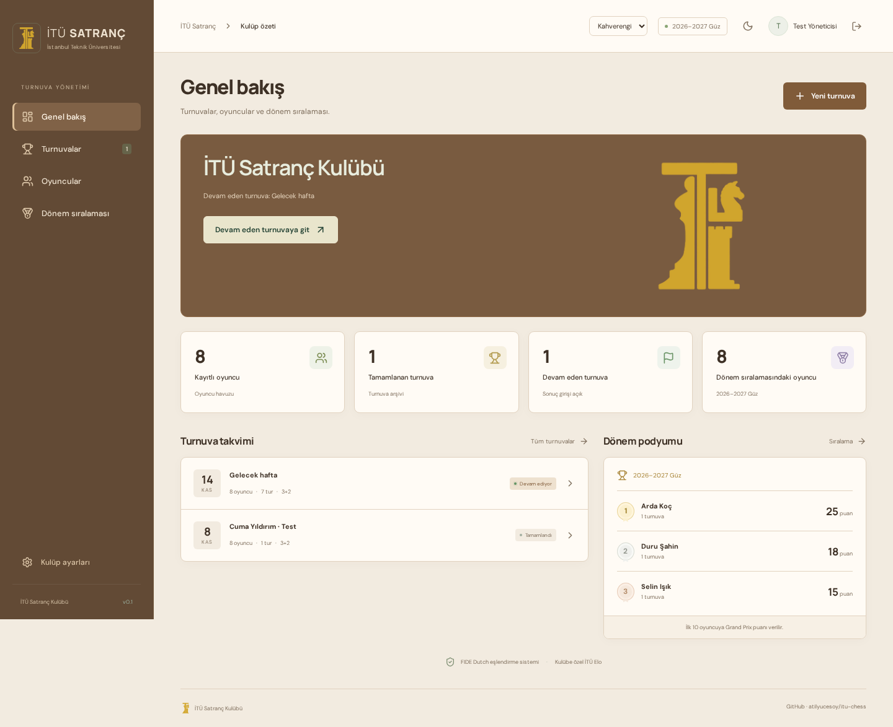

# İTÜ Satranç

[](https://github.com/atilyucesoy/itu-chess/actions/workflows/ci.yml)

A tournament-management web application built for Istanbul Technical University's chess club: reusable player profiles, FIDE Dutch Swiss pairing, a separate club Elo system, and semester Grand Prix standings. The UI is Turkish.

**Live application: [itu-chess.onrender.com](https://itu-chess.onrender.com)** · Free hosting may take about a minute to wake after inactivity. The app starts with an empty real club database; screenshots below use fictional test fixtures.

**Stack:** React, TypeScript, Vite, Express, SQLite / Supabase Postgres. Pairings use the external **bbpPairings 6.0.0** engine, not a simplified custom Swiss implementation.



Screenshots use fictional automated-test data, not real club records. [1080p projection / 40 players](docs/screenshots/projection.png) · [Standings](docs/screenshots/standings.png) · [Mobile layout](docs/screenshots/mobile-overview.png) · [Architecture and trade-offs](docs/architecture.md)

## Run locally

Linux x64, Node **22.13+**, npm, `tar` required. Older glibc hosts also need `g++` (C++20) and `make` to build the verified engine source automatically. No paid services or API keys required locally.

```bash
git clone https://github.com/atilyucesoy/itu-chess.git
cd itu-chess
npm ci
npm run setup
npm run engine:install
npm run dev
```

Open **http://localhost:5173**. Setup prints the unique initial owner password and saves it in ignored, mode-0600 `.env`. There is **no default password**. Username: `atil`. You can change passwords and create individual organizer accounts in **Kulüp ayarları**. The bootstrap environment password is only used if no accounts exist; changing `.env` later does not reset an existing account.

Local database: `data/club.sqlite`. Do not delete it or store it on an ephemeral hosted disk. The site starts empty: no invented players or results are mixed with real club data.

## Developer mode: disposable test tournaments

`npm run dev` enables developer mode on the local server. Sign in as the owner, open **Kulüp ayarları → Developer mode → Deneme ortamını aç**. A persistent yellow banner identifies the test workspace. Add names such as `abc`, create a tournament, enter results and finalize normally.

- The test workspace starts empty and copies **only rating policy and semester configuration**, never actual players, tournaments or accounts.
- All test state lives in an isolated **in-memory store**, not the club's SQLite/Supabase database. It does not enter real rating history, points, audit records or backups.
- **Denemeyi sıfırla** clears all test players, events, rating changes, corrections and audit entries. **Kulüp kayıtlarına dön** clears and discards the test workspace before returning to actual club data.
- Test state is also discarded on logout, server restart or after four hours. An expired workspace never silently accepts mutations against actual club records. Explicit workspace checks and monotonic revisions reject stale requests.
- Only the owner can enter developer mode. Account management and full backups are disabled inside a test workspace.
- Developer mode requires `ENABLE_DEVELOPER_MODE=1` and is **always disabled when `NODE_ENV=production`**, even if that flag is set. The bundled `dev` script sets the flag; a normal `npm start` does not.
- Test CSV/TRF files you explicitly download are outside the workspace and are not removed from your computer by reset. Memory disposal is an application-level isolation guarantee, not a forensic secure-erasure guarantee for operating-system memory or external logs.

Tabs in the same browser share the workspace cookie. Use a separate browser profile if you need to view actual club records and a test workspace simultaneously. The automated browser test verifies that a complete test tournament, reset and exit leave the actual club backup **unchanged**, including its revision.

## Weekly workflow

1. Sign in, add people in **Oyuncular**, with optional FIDE standard Elo or UKD.
2. Create a standard chess event. Defaults: **7 rounds**, **3+2**, and the club's active semester. Choose a registered semester and whether the event contributes championship points and/or İTÜ Elo. There is no variant/mode selection.
3. Select existing players, or copy the most recent tournament's participant list. **Save the list** before generating the first round.
4. Generate a round; enter wins, draws or forfeits. All results must be complete before pairing the next round.
5. Between rounds, mark withdrawals/returns from **Oyuncular**. Withdrawn players receive explicit zero-point absences, not rating losses. For a later arrival use **Geç katılım ekle**; select registered players or create a new one directly.
6. After the planned final round, resolve any complete tie with a **recorded random lot**, then finalize. Finalization awards points and updates ratings once. It cannot be run twice.

The total rounds can be changed **before starting**, not silently changed mid-event. First-round initial colour is randomly drawn once and stored. If the engine cannot create valid pairings, it reports failure; it never falls back to an improvised pairing algorithm. For very small fields, choose a feasible number of Swiss rounds before starting.

### Late entries

Organizers can admit players while an event is live, before the final round has been paired. They start at the next unpaired round; all earlier missed rounds score **zero** and are excluded from Elo. Published boards, colours, results and saved original round TRFs are unchanged. FIDE C.04.2 2.4–2.5 permits provisional pairing-number reassignment for late entries: the combined field is re-numbered using frozen strength values (İTÜ Elo first), while games keep their stable player UUIDs. Missing pre-entry rounds are exported as colourless zero-point absences and included in the supported unplayed-round tie-break handling.

Creating a new player and admitting them is one atomic action. Duplicate players and admissions after the final pairing are rejected. If later rounds are explicitly undone, pending participants become eligible for the next re-pairing; this does not silently change an existing published round.

### Projecting pairings

From the event page choose **Tam ekran eşlendirmeler**, then **Tam ekran** to use the browser's native full-screen mode (or F11 if the browser refuses it). The projection route `#projection/<event-id>` is read-only and accessible without organizer login for actual club events. Navigation and result-entry controls are hidden.

Names, both ratings, table numbers and piece colours are enlarged. A normal 40-player field fits as 20 boards in two columns on a 1920×1080 screen. Smaller screens and unusually long names use pagination instead of silently clipping players. Use the next/previous board controls to see every table. The default **Son tur (otomatik)** follows new pairings through the existing 20-second refresh; selecting a specific older round keeps that round visible. A manual refresh control is also available. Sandbox projections are clearly labeled and remain confined to the same browser session.

### Appearance and semesters

- Brown is the only palette. Use the header light/dark toggle or **Kulüp ayarları → Görünüm → Koyu görünüm**; that preference is saved only in the current browser. Old saved green-palette preferences are discarded. Pairing names, ratings and white/black headings are centered, with intermediate-sized type rather than the earlier oversized table text.
- The owner manages **Kulüp ayarları → Dönemler**. Create a period, optionally activate it immediately, or select an existing period and use **Aktif dönemi kaydet**.
- The header badge always shows the **active semester**. New events default to it. The semester standings page can independently display an older semester without changing the club's active one.
- Semester rollover is deliberate, not a calendar-triggered reset. Old events and semester points are preserved, and İTÜ Elo carries forward. Existing event labels are imported unchanged into the registry when upgrading; the latest legacy event's period is the initial active choice. A new empty installation receives a one-time date-based suggestion, which the owner can change.
- Existing backups remain restorable. Migration adds semester metadata only; it does not rewrite games, ratings, account data or historical event labels. New events only use registered semester names, avoiding spelling-based duplicate leaderboards.

### Ratings and seeding

**Always İTÜ Elo first → entered official Elo/UKD → configurable reference.** At tournament start the app refreshes and freezes these values. Swiss scores, not rating proximity, drive later score groups; frozen pairing numbers provide seeding. A later official-rating edit never overrides an established İTÜ Elo.

Two columns/values are displayed independently: İTÜ Elo first, official rating second. İTÜ Elo remains empty until a player completes at least one actually played game in an Elo-enabled event (or receives an explicit owner correction).

Defaults, editable by the owner:

- Unrated reference: **1500**. It's a temporary seed, not an initial displayed İTÜ Elo.
- Unrated first rating: `mean(opponent starting ratings) + 400 × log10((score + 0.5)/(games − score + 0.5))`. This club estimator is smoothed for zero/perfect results and can produce a high first rating.
- Alternative initial method: reference + ordinary Elo change.
- Players with official ratings start from those, applying Elo change, not from zero.
- K=40 for the first 30 played rated games, K=20 afterwards. Transition can happen within a tournament; expected scores always use frozen starting values.
- Logistic expected score `1/(1+10^((opponent−player)/400))`. Each event's total change is rounded once. Displayed ratings are constrained to 100–3500.
- Byes, requested absences and forfeits excluded. No effect on official Elo/UKD.

This is a **club rating**, not FIDE's rating calculation. Official Elo and UKD are accepted as manually chosen seeds; they are not claimed to be identical scales. If most players are unrated, the numerical scale is anchored by the configured reference and available official seeds; results alone cannot determine an absolute scale.

Policy changes affect newly started events. **Geçmişi yeniden hesapla** explicitly replays all completed rating events in finalization order with the new policy, including timestamped manual corrections. Original pairings and starting snapshots are preserved (they describe what actually happened); rating-history values are recalculated. A ratings change never re-pairs an old event. Only one rating-enabled event may be live at a time.

### Standings and Grand Prix

- Win 1, draw ½, loss 0. Pairing-allocated bye 1, absent 0.
- Tie-break order: **score → Buchholz Cut-1 → Buchholz → Sonneborn-Berger → recorded lot**. Implements the March 2026 FIDE C.07 unplayed-round adjustments for the supported result types. Live tie-breaks are provisional.
- F1 schedule: **25–18–15–12–10–8–6–4–2–1**. Only completed events with `Dönem puanlarına dahil` count.
- Semester standings are separate; İTÜ Elo continues across semesters. Events select a period from the central registry.
- Season ties use countback: number of firsts, then seconds, etc. If still equal, the season table shares the rank (`=`); alphabetical ordering is display-only.
- Medal podiums, profiles, rating graphs, CSV exports, organizer TRF export and public shareable event links.

### Correcting mistakes

Current-round results are editable. To change an earlier result, explicitly undo later rounds first; this removes their results too. Finalized events require owner reopening, which removes championship contributions and replays ratings. A rated event cannot be reopened while another rated event is live, or while later rated events remain finalized; work backwards from the latest. This protects downstream rating history.

## Free internet hosting

**Türkçe, ekran ekran kurulum ve turnuva gecesi kontrol listesi: [YAYINLAMA.md](YAYINLAMA.md).** İstersen yalnız ilk Supabase giriş adımını yapıp kalanını birlikte ilerleyebilirsin; hiçbir gizli anahtarı sohbete göndermek gerekmez.

The public deployment uses Render Free and Supabase. To create your own deployment, you need a free GitHub account, Render account and Supabase project. Organizer accounts inside the website do **not** require hosting-provider accounts.

1. Create a **Supabase Free** project. Run **`supabase/schema.sql`** in its SQL editor. Tables and RPC are private to the server's service-role key; anonymous/authenticated browser clients cannot read raw state or password hashes.
2. Fork or clone [atilyucesoy/itu-chess](https://github.com/atilyucesoy/itu-chess). Keep `.env`, `data/`, `bin/`, `node_modules/` excluded from Git.
3. In Render, create a Blueprint using **`render.yaml`**, selecting **Free**. Or create a Node web service manually:
   - Build: `npm ci && npm run engine:install && npm run build`
   - Start: `npm start`
   - Health endpoint: `/api/health`
4. Set `SUPABASE_URL`, `SUPABASE_SERVICE_ROLE_KEY`, a 32+-character `SESSION_SECRET`, `ADMIN_USERNAME`, `ADMIN_NAME`, and a 12+-character `ADMIN_PASSWORD`. Set `NODE_ENV=production`, and `APP_ORIGIN` to the site's exact HTTPS origin, e.g. `https://itu-satranc.onrender.com` (no trailing slash). Blueprint generates the secret.
5. Sign in and add your friends as organizers. Use a free `onrender.com` address; buying a domain is unnecessary.

**Do not put the service-role key in any `VITE_` variable.** It belongs only on the server. Production refuses to start with local SQLite unless you explicitly opt into a genuinely persistent self-hosted disk.

Free-tier caveats, checked November 2026: Render free web services sleep after 15 idle minutes and may take about a minute to wake. Supabase Free can pause after a week of inactivity and doesn't include automatic backups. Resume it manually after a long break. Render **Free Postgres expires after 30 days**, so we deliberately do not use it. Free quotas/terms can change; don't enable paid upgrades or add billing without intending to. Hosting is not guaranteed-availability infrastructure; take backups and test the site before club night.

Sources: [Render Free](https://render.com/docs/free), [Supabase pricing](https://supabase.com/pricing).

## Security and data

- Owner manages accounts, policies, manual corrections, replay and full backups. Organizers manage participants, tournaments and results. Public visitors have read-only access.
- Passwords use salted scrypt hashes. Signed sessions expire after 12 hours, use HttpOnly, SameSite=Strict, and Secure in production. Changing a password or removing an account revokes its sessions.
- Origin checks, request throttling, payload validation, security headers, no-cache API responses, revision-checked atomic saves. A conflicting save is rejected rather than overwriting another organizer's work.
- Public responses exclude accounts, raw TRFs, correction reasons and audit logs. Player names and entered ratings are public: inform participants and obtain any necessary consent. Do not enter student numbers, private contact details, or birthdates in names.
- The owner backup includes password hashes and must be kept private. Download after events. See `npm run backup:restore -- <file> --confirm-replace` for explicit operator recovery; stop the app first. Never commit backups.
- Audit retains the latest 2,000 action summaries (who/when/type), not a forensic history of every before/after value. Tournament snapshots and rating corrections retain their domain-specific history.
- Data storage uses a single versioned JSON document, with atomic compare-and-swap in SQLite or a private Supabase RPC. Suitable for this small club, not intended as a large multi-tenant platform. Keep exports as independent backups.
- A five-second, copy-isolated primary-store read cache coalesces spectator reads and is invalidated by successful CAS writes. Conditional polling uses ETags over the complete permission-filtered response, avoiding unchanged payload downloads without reusing private/sandbox representations across auth boundaries. The source CAS remains authoritative; caching does not turn stale writes into successful ones or bypass access checks.
- Startup executes a real two-player pairing self-test before the server listens. Its temporary data never enters any persistent store. `/api/health` reports `engineReady: true` only after that check passes, rather than merely checking whether the binary file exists.

## Verification

```bash
npm test                # real engine integration + ratings + standings + auth
npm run build           # strict TypeScript and production build
npx playwright install chromium
npm run test:e2e        # isolated temporary database, never real club data
```

Tests include full seven-round even/odd tournaments, no repeated played opponents, colours, byes, forfeits, withdrawal/return, seeding priority, first-rated and unrated initialization, policy replay, finalization/reopening, tie resolution, semester exclusions, private data, permissions and edit conflicts. Developer-mode tests cover owner-only access, production gating, memory disposal, reset races, expired-session handling and unchanged real club data. Further tests cover late-entry admission and missed rounds, published-round integrity, safe semester migration/rollover, old backup compatibility, brown-only dark-mode persistence, a 40-player projection at 1080p, live round updates, native fullscreen, smaller-screen pagination, cache invalidation and authentication-aware conditional polling. GitHub Actions runs the unit/integration tests and browser tests on pushes to `main` and pull requests.

## Pairing rules and licensing

bbpPairings is downloaded from the pinned v6.0.0 release with SHA-256 verification; upstream Apache-2.0 license and notices are retained in `bin/bbpPairings-v6.0.0/`. If the official executable needs a newer glibc than the host provides (as on Render), installation compiles the **same unchanged v6.0.0 source**, pinned by commit and archive SHA-256, using the host's C++20 compiler. `npm run engine:install -- --source` forces that path, and CI tests the source-built engine. This is not a replacement pairing algorithm. It supports the Dutch rules effective February 2026. This application **is not FIDE-endorsed**, does not submit events to FIDE, and does not claim certification based on using an existing engine. No hand-written Swiss fallback is used.

- [FIDE Dutch, February 2026](https://handbook.fide.com/chapter/C0403202602)
- [FIDE tie-breaks, March 2026](https://handbook.fide.com/chapter/TieBreakRegulations032026)
- [bbpPairings v6.0.0](https://github.com/BieremaBoyzProgramming/bbpPairings/releases/tag/v6.0.0)

Interface inspiration: restrained Lichess-style usability, with original club styling. No Lichess branding or assets. Google Fonts are optional; local system fonts remain usable when unavailable. `src/style.css` contains the base layout; `src/enhancements.css` supplies the fixed brown theme, centered pairing typography and projection layout.
